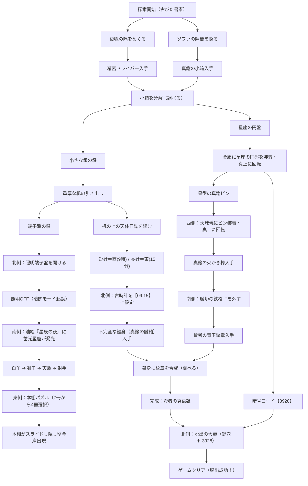

# 開発日記 (DEVLOG) - 『古びた書斎と賢者の鍵』

本ドキュメントは、謎解き脱出Webゲーム『古びた書斎と賢者の鍵』の開発背景、採用技術、日付別の開発記録、および今後の改善課題をまとめた開発ログです。  
今後は開発・修正を行うごとに、日付別ログ（セクション2）へ新しい日付の見出しを追加・更新していきます。

---

## 1. プロジェクト概要

### ■ ゲームコンセプト
クラシカルな洋館の書斎を舞台にした、本格派のポイント＆クリック型脱出ゲームです。  
プレイヤーは360度（北・東・南・西の4画面）を切り替えながら部屋を探索し、隠された道具の発見、アイテムの分解・合成、照明スイッチによる「暗闇モード」での隠し要素発見、天体運行に基づく多層暗号パズルを解き明かして、頑丈な大扉からの脱出を目指します。

### ■ 技術スタック & アーキテクチャ
外部フレームワークや重いゲームエンジンに依存せず、軽量で高速に動作するモダンなWeb標準技術で構築されています。

- **フロントエンド構造**: HTML5 + Vanilla JavaScript (ES6+) + CSS3
- **グラフィック**: 全画面・全オブジェクト・アイテムアイコンを「軽量なインラインSVG」で直接ベクター描画（高解像度ディスプレイ・Retina・スマホでも鮮明）
- **サウンドシステム ([se.js](file:///c:/Users/xcang/Desktop/Antigravity/escape/se.js))**: Web Audio API による自前シンセ音源（クリック音、解錠音、ドライバー回転音、時計チクタク、正解ファンファーレ等をコード生成するため、外部mp3/wavファイルのロード不要で動作）
- **セーブシステム**: `localStorage` を利用したオートセーブ（ゲーム中断・再開・クリアタイム記録対応）
- **レスポンシブ & タイポグラフィ**: スマホ（iPhone等）での片手操作に最適化（`touch-action: manipulation`, `viewport-fit=cover`, `font-size: clamp()`, `word-break: auto-phrase`, `text-wrap: balance/pretty`）

### ■ ファイル構成
```text
c:\Users\xcang\Desktop\Antigravity\escape\
├── index.html       # メインDOM構造、メニュー画面、SVGルームビュー、モーダル群
├── script.js        # ゲームステート管理、パズルロジック、モーダル展開、セーブ機能
├── style.css        # アンティーク調UIデザイン、レスポンシブ組版、アニメーション
├── se.js            # Web Audio API シンセ効果音マネージャー
├── DEVLOG.md        # 本開発日記・技術ドキュメント（日付別運用）
├── README.md        # プロジェクト概要・プレイガイド
└── .gitignore       # OS一時ファイル・エディタ設定等のGit除外設定
```

---

## 2. 日付別 開発記録 (Daily Development Log)

### 2026-10-27 (火)

#### 1. 初期プロトタイプ構築 & スマホ最適化 (12:00〜13:00)
- **4方向探索システムの作成**: 北・東・南・西の視点旋回UIおよびSVGグラフィックの初期配置。
- **基本アイテム・ギミック**: 机、引き出し、時計、絵画、絨毯、大扉のプロトタイプ実装。
- **ステージ選択 & セーブ機能**:
  - タイトル画面（Stage 1 カード表示、クリアタイム記録、続きからプレイ）。
  - `localStorage` によるリアルタイムオートセーブ機能。
- **スマホUI調整**: アイテムスロットのタッチ操作、アイテム選択ピッカーUIの導入。

#### 2. Stage 1 フルリメイク & ギミック本格化 (14:00〜15:30)
- **照明スイッチ盤 ＆「暗闇モード」**:
  - 北側の壁に真鍮カバー付き照明端子盤を新設。
  - 明かりを消すと部屋全体が深い夜のトーンに変わり、油絵や本棚に蓄光塗料が浮かび上がる演出を追加。
- **アイテム分解・合成システム**:
  - アイテム詳細モーダルから【調べる】アクションを追加。
  - ドライバーで「真鍮の小箱」を分解（銀の鍵＋星座の円盤）。
  - 「不完全な鍵身」と「賢者の青玉紋章」を結合して「賢者の真鍮鍵」を精錬。
- **パズルロジックの高度化と二重ヒント解消**:
  - **天体日誌**: 時計パズル専用とし、東西方位から長針・短針（9時15分）を推測する詩文に変更。
  - **油絵『星辰の夜』**: 通常時と拡大時の構図を100%統一。暗闇時に浮かぶ星座の軌跡を本棚パズルの解法ヒントに特化。
  - **本棚パズル**: 当てずっぽうでの総当たりを防止するため、本を7冊（840通り）に拡張。4冊押すまで成否を伏せる仕様に改善。
  - **西側（ソファ室）の役割強化**: サイドテーブルに「真鍮の天球儀」を配置し、中盤から終盤への架け橋となるキーアイテム（火かき棒）を入手するギミックを実装。
- **UIクリーンアップ**:
  - 画面上部の音量ボタン・最初から・メニュー戻りボタンを撤去し、歯車アイコンの「設定モーダル」に集約。

#### 3. タイポグラフィ・組版 & 日本語改行の徹底最適化 (15:30〜16:40)
- **モダンCSS改行ルールの適用**:
  - `word-break: auto-phrase;` と `overflow-wrap: anywhere;` を設定し、単語・文節途中での不自然な折り返しを防止。
  - 見出しに `text-wrap: balance;`、説明文に `text-wrap: pretty;` を設定。
  - ボタンやステータスラベルに `white-space: nowrap;` と `font-size: clamp()` を適用。
- **メッセージバー & モーダル説明文の改善**:
  - メッセージバー（`setMessage`）でスラッシュ（`/`）や改行（`\n`）による自動インラインブロック（`<span style="display:inline-block;">`）分割に対応。
  - アイテム詳細モーダルでHTMLタグが文字列として露出していた不具合（`innerText` ➔ `innerHTML`）を修正。
  - 引き出し、時計、暖炉、壁金庫、天球儀、アイテム選択ピッカーなどの説明文を `<span class="phrase">` による意味単位の構造化と中央揃えに統一。

#### 4. 環境整備 & ドキュメンテーション (16:50〜17:35)
- **[.gitignore](file:///c:/Users/xcang/Desktop/Antigravity/escape/.gitignore) の策定**: Windows / macOS / VS Code / Node等の一時ファイルが混入しないよう除外ルールを整備。
- **[DEVLOG.md](file:///c:/Users/xcang/Desktop/Antigravity/escape/DEVLOG.md) の作成**: プロジェクト全体の技術仕様、パズル全体の解法フローチャート、日付別開発記録、今後のリファクタリング計画を明文化。
- **[README.md](file:///c:/Users/xcang/Desktop/Antigravity/escape/README.md) の作成**: オンラインプレイリンク、ストーリー、各ギミックの特徴、操作マニュアル、技術構成をまとめた公式プレイガイドを整備。

---

## 3. 現在の謎解きフローチャート



---

## 4. 今後リファクタリングや改善が必要な課題

1. **`script.js` のモジュール分割（ES Modules化）**
   - 約1,950行の単一ファイルを `state.js`、`items.js`、`puzzles/`、`ui.js` に分離し、保守性と可読性を向上させる。

2. **テキスト処理パイプラインの統一**
   - `setMessage` とモーダル内テキストで分かれている文節スパン分割ロジックを単一のユーティリティ関数（例: `formatPhrases(text)`）に集約する。

3. **マルチステージ化（Stage 2以降）への拡張性**
   - ステージ設定（初期状態、アイテム、ギミックロジック）を抽象化し、新たな部屋やステージを容易に追加できる仕組みを導入する。

4. **キーボード・アクセシビリティ対応**
   - PC環境での左右矢印キーによる視点旋回や、Escキーでのモーダル閉じをサポートする。
