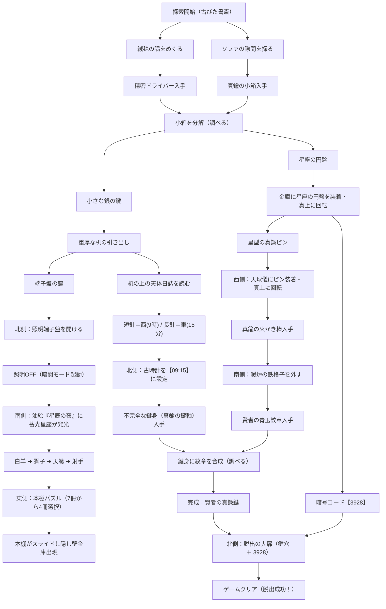

# 開発日記 (DEVLOG) - 『古びた書斎と賢者の鍵』

本ドキュメントは、謎解き脱出Webゲーム『古びた書斎と賢者の鍵』の開発背景、採用技術、開発履歴、および今後の課題・リファクタリング計画をまとめた開発記録です。

---

## 1. プロジェクト概要

### ■ ゲームコンセプト
クラシカルな洋館の書斎を舞台にした、本格派のポイント＆クリック型脱出ゲームです。  
プレイヤーは360度（北・東・南・西の4画面）を切り替えながら部屋を探索し、隠された道具の発見、アイテムの分解・合成、照明スイッチによる「暗闇モード」での隠し要素発見、天体運行に基づく多層暗号パズルを解き明かして、頑丈な大扉からの脱出を目指します。

### ■ 技術スタック & アーキテクチャ
外部フレームワークや重いゲームエンジンに依存せず、軽量で高速に動作するモダンなWeb標準技術で構築されています。

- **フロントエンド構造**: HTML5 + Vanilla JavaScript (ES6+) + CSS3
- **グラフィック**: 全画面・全オブジェクト・アイテムアイコンを「軽量なインラインSVG」で直接ベクター描画（高解像度ディスプレイ・Retina・スマホでも鮮明）
- **サウンドシステム ([se.js](file:///c:/Users/xcang/Desktop/Antigravity/escape/se.js))**: Web Audio API による自前シンセ音源（クリック音、解錠音、ドライバー回転音、時計チクタク、正解ファンファーレ等をコード生成するため、外部mp3/wavファイルのロード不要で動作）
- **セーブシステム**: `localStorage` を利用したオートセーブ（ゲーム中断・再開・クリアタイム記録対応）
- **レスポンシブ & タイポグラフィ**: スマホ（iPhone等）での片手操作に最適化（`touch-action: manipulation`, `viewport-fit=cover`, `font-size: clamp()`, `word-break: auto-phrase`, `text-wrap: balance/pretty`）

### ■ ファイル構成
```text
c:\Users\xcang\Desktop\Antigravity\escape\
├── index.html       # メインDOM構造、メニュー画面、SVGルームビュー、モーダル群
├── script.js        # ゲームステート管理、パズルロジック、モーダル展開、セーブ機能
├── style.css        # アンティーク調UIデザイン、レスポンシブ組版、アニメーション
├── se.js            # Web Audio API シンセ効果音マネージャー
├── DEVLOG.md        # 本開発日記・技術ドキュメント
└── .gitignore       # OS一時ファイル・エディタ設定等のGit除外設定
```

---

## 2. これまでの主な開発履歴 (Gitコミットマイルストーン)

これまでのコミットログに基づく主要な開発の流れと改善記録です。

| 日時 | コミット | 主な実装・改善内容 |
| :--- | :--- | :--- |
| **10/27 12:22** | `1d353b8` / `5a7381c` | **プロジェクト初期立ち上げ**: 4方向ビュー、基本アイテムと部屋ギミックのプロトタイプ構築。 |
| **10/27 12:41** | `d472e49` | **スマホ対応 & UI改善**: 時計針の修正、絵画ヒントの連動、アイテムピッカーUIの導入。 |
| **10/27 12:53** | `9048978` | **ステージ選択 & セーブ機能**: タイトルメニュー、`localStorage` オートセーブ、クリア記録システムの実装。 |
| **10/27 14:41** | `395c2c8` | **Stage 1 フルリメイク**: 照明スイッチによる「暗闇（ナイト）モード」、アイテム分解（小箱＋ドライバー）や合成（鍵身＋紋章）、スライド金庫パズルの追加。 |
| **10/27 14:52** | `fc839da` | **ヒント整理 & アンティークSVG化**: 重複していたヒントを排除し、絵文字表現を古代シンボル風ベクターSVGに一新。 |
| **10/27 15:04** | `6dfe3bb` | **パズル本格化**: 本棚パズルを7冊（840通り）に拡張し総当たり・当てずっぽうを抑止。日誌から時計の東西方位を推測させる多層構造化。 |
| **10/27 15:21** | `8c07c0e` | **西側（ソファ室）の役割強化**: ソファ脇のサイドテーブルに「真鍮の天球儀」を配置し、中盤〜終盤にかけての重要ギミックへ昇格。 |
| **10/27 15:28** | `c3ed567` | **設定モーダルの集約**: 画面上部の散乱していたボタン（音量、リセット、メニュー戻り）を歯車アイコンの「設定ダイアログ」に統合しUIを整理。 |
| **10/27 15:40** | `fd62f65` | **組版・タイポグラフィ改善**: モダンCSS（`auto-phrase`, `balance`, `pretty`, `clamp`）と文節ブロック（`<span class="phrase">`）による日本語改行の徹底最適化。 |
| **10/27 16:01〜16:20** | `cfbae01`〜`449e51b` | **メッセージバーの分割記法対応**: `/` や `\n` 区切りでメッセージをインラインブロック化する機能の追加・調整。 |
| **10/27 16:23** | `218e30a` | **アイテム詳細表示の修正**: `innerText` による生HTMLコード露出バグを `innerHTML` と自動文節変換へ修正。 |
| **10/27 16:30〜16:37** | `74ee648`〜`dd89b88` | **各種モーダル文言のレイアウト調和**: 引き出し、時計、金庫、暖炉などの説明テキストの中央揃え・文節改行を統一。 |
| **10/27 16:56** | `bc79b11` | **環境整備**: OS一時ファイルやエディタ設定を対象とした `.gitignore` を追加。 |

---

## 3. 現在の実装状況と今後のリファクタリング・改善課題

### ■ 現在の実装状況（完成度）
Stage 1（古びた書斎と賢者の鍵）の謎解きルートは完全に一本の美しいフローとして完成しており、ノーヒントでも観察と推理によって解き進められる高い完成度に達しています。



---

### ■ 今後リファクタリングや改善が必要な課題

1. **`script.js` のモノリシック肥大化の解消（モジュール分割）**
   - **現状**: `script.js` が約1,950行の1ファイルにまとまっており、状態定義・SVGテンプレート・イベントリスナー・各ギミックのロジックが同居している。
   - **改善案**: ES Modules（`<script type="module">`）を採用し、役割ごとにファイルを分割する：
     - `src/state.js`（ゲーム状態・セーブ／ロード）
     - `src/items.js`（アイテム定義・分解合成ロジック）
     - `src/puzzles/`（本棚、時計、天球儀、金庫、大扉などの各ギミック処理）
     - `src/ui.js`（モーダル表示・メッセージ表示・インベントリ描画）

2. **テキスト・メッセージ処理の統一**
   - **現状**: `setMessage` ではスラッシュや改行による動的スプリットを行い、モーダル内HTMLでは `<span class="phrase">` を手動記述している。
   - **改善案**: 共通のヘルパー関数（例: `renderPhraseText(text)`）を用意し、どちらの形式の文字列でも一貫して美しい文節インラインブロックへ変換する共通パイプラインを設ける。

3. **マルチステージ化（Stage 2以降）への拡張性**
   - **現状**: メニュー画面には「STAGE 1」のバッジやステージカードがあるが、JavaScript内部はStage 1のフラグが直書きされている。
   - **改善案**: ステージごとの初期状態やギミック定義を「Stage設定オブジェクト」として外出しし、Stage 2（例: 『地下牢と錬金術師の実験室』など）を容易に追加できるステージ管理クラスを構築する。

4. **アクセシビリティ & キーボード操作対応**
   - **現状**: タップ/クリックを前提とした操作体系。
   - **改善案**: 左右矢印キーでの視点旋回（← / →）、`Esc` キーでのモーダル閉じ、`Tab` キーによるフォーカス移動をサポートすることで、PCブラウザ環境での操作快適性をさらに高める。
