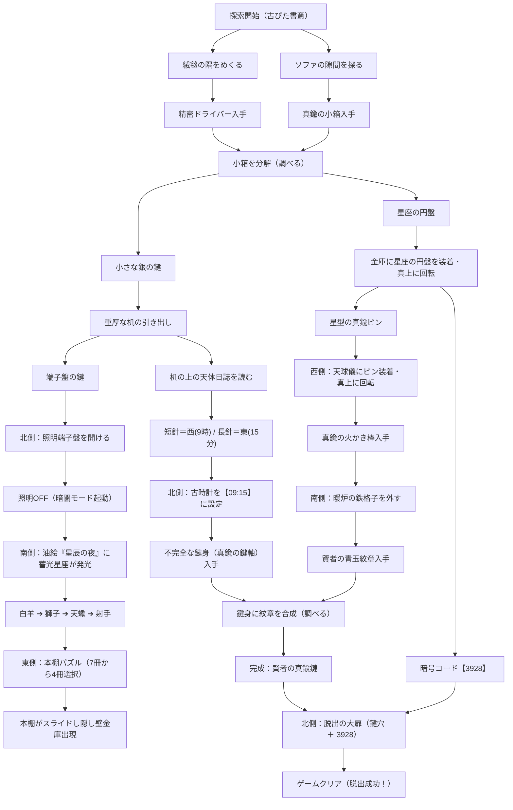

# 開発日記 (DEVLOG) - 『密室の謎解き脱出』(Mystery Escape Game)

本ドキュメントは、謎解き脱出Webゲーム『密室の謎解き脱出』の開発背景、採用技術、日付別の開発記録、および今後の改善課題をまとめた開発ログです。  
現在はStage 1「古びた書斎と賢者の鍵」を公開中であり、今後は複数ステージの追加・拡張を予定しています。  
開発・修正を行うごとに、日付別ログ（セクション2）へ新しい日付の見出しを追加・更新していきます。

---

## 1. プロジェクト概要

### ■ ゲームコンセプト
様々なシチュエーションの密室を舞台にした、本格派のポイント＆クリック型脱出ゲーム集です。  
プレイヤーは360度（北・東・南・西の4画面）を切り替えながら部屋を探索し、隠された道具の発見、アイテムの分解・合成、照明スイッチによる「暗闇モード」での隠し要素発見、天体運行に基づく多層暗号パズルを解き明かして、頑丈な大扉からの脱出を目指します。

### ■ 技術スタック & アーキテクチャ
外部フレームワークや重いゲームエンジンに依存せず、軽量で高速に動作するモダンなWeb標準技術で構築されています。

- **フロントエンド構造**: HTML5 + Vanilla JavaScript (ES6+) + CSS3
- **グラフィック**: 全画面・全オブジェクト・アイテムアイコンを「軽量なインラインSVG」で直接ベクター描画（高解像度ディスプレイ・Retina・スマホでも鮮明）
- **サウンドシステム ([se.js](file:///c:/Users/xcang/Desktop/Antigravity/escape/se.js))**: Web Audio API による自前シンセ音源（クリック音、解錠音、ドライバー回転音、時計チクタク、正解ファンファーレ等をコード生成するため、外部mp3/wavファイルのロード不要で動作）
- **セーブシステム**: `localStorage` を利用したオートセーブ（ゲーム中断・再開・クリアタイム記録対応）
- **レスポンシブ & タイポグラフィ**: スマホ（iPhone等）での片手操作に最適化（`touch-action: manipulation`, `viewport-fit=cover`, `font-size: clamp()`, `word-break: auto-phrase`, `text-wrap: balance/pretty`）

### ■ ファイル構成
```text
c:\Users\xcang\Desktop\Antigravity\escape\
├── index.html            # メインDOM構造、メニュー画面、SVGルームビュー、PWAメタタグ
├── script.js             # ゲームステート管理、パズルロジック、モーダル展開、セーブ機能
├── style.css             # アンティーク調UIデザイン、レスポンシブ組版、アニメーション
├── se.js                 # Web Audio API シンセ効果音マネージャー
├── manifest.json         # Web App Manifest（スタンドアロン起動・アプリアイコン定義）
├── icon.svg              # アプリアイコン（ベクター原画：真鍮の賢者の鍵＆コバルトブルー宝石）
├── icon-192.png          # Android/PWA用標準アプリアイコン（192x192px）
├── icon-512.png          # Android/PWAスプラッシュ用アプリアイコン（512x512px）
├── apple-touch-icon.png  # iOS Safari ホーム画面追加用高精細アイコン（180x180px）
├── favicon.png           # PCブラウザ用タブファビコン（48x48px）
├── wrangler.json         # Cloudflare Workers Builds / 静的サイト（assets & previews）設定
├── DEVLOG.md             # 本開発日記・技術ドキュメント（日付別運用）
├── README.md             # プロジェクト概要・プレイガイド
└── .gitignore            # OS一時ファイル・エディタ設定等のGit除外設定
```

---

## 2. 日付別 開発記録 (Daily Development Log)

### 2026-10-30 (金)

#### 1. アプリアイコン制作・PWAマニフェスト対応・全画面スタンドアロン起動の実装
- **ブランチ作成**: `feat/app-icon-and-pwa` 作業用ブランチを作成して実装。
- **オリジナルアプリアイコンのデザイン & マルチ解像度生成**:
  - 本作の世界観（クラシカルな洋館・密室ミステリー）に合わせ、チャコールブラック（`#121316`）の背景に真鍮の二重枠線、そして中央に青玉（コバルトブルー宝石）を嵌め込んだ重厚な真鍮の「賢者の鍵」をモチーフとした `icon.svg` をオリジナル制作。
  - スマホのホーム画面で小さく表示されても一目で脱出ゲームと識別できるよう、文字を省きモチーフとシャドウを際立たせた設計を採用。
  - 高解像度ベクターから高品質リサンプリング（Lanczos）を行い、各プラットフォーム向けに最適化されたアイコンファイルを生成・配置：
    - `icon.svg`（ベクターマスター画像）
    - `apple-touch-icon.png`（iOS Safari「ホーム画面に追加」用 180×180px）
    - `icon-192.png`（Android PWA / ホーム画面用 192×192px）
    - `icon-512.png`（高解像度ディスプレイ・スプラッシュ画面用 512×512px）
    - `favicon.png`（PCブラウザタブ用 48×48px）
- **Web App Manifest (`manifest.json`) の新規作成**:
  - `name`: 「密室の謎解き脱出 - Mystery Escape Game」
  - `short_name`: 「密室脱出」（ホーム画面のアプリ名として最適な4文字表記）
  - `display`: `"standalone"`（ブラウザのアドレスバー・ナビゲーションバーを非表示にし、ネイティブアプリのように全画面起動）
  - `background_color` / `theme_color`: ゲームの統一ダークトーン `#121316` を指定。
  - `icons`: SVG、192px、512px（`purpose: "any maskable"`）、180px をすべて登録。
- **`index.html` ヘッダーへのメタタグ拡充**:
  - PCファビコン指定（`icon.svg`, `icon-192.png`, `favicon.png`）
  - iPhone / iPad ホーム画面用アイコン指定（`apple-touch-icon.png`）
  - Android / PWA用マニフェストリンク（`manifest.json`）
  - iOSスタンドアロン起動設定（`apple-mobile-web-app-capable: yes`, `apple-mobile-web-app-status-bar-style: black-translucent`, `apple-mobile-web-app-title: 密室脱出`）
  - Android Web App起動設定（`mobile-web-app-capable: yes`, `theme-color: #121316`）

#### 2. Cloudflare Workers Builds / 静的サイト配信設定の追加
- **`wrangler.json`（Static Assets & Worker Previews設定）の構成**:
  - Cloudflare Workers Builds のプレビュービルドおよび静的アセット配信に対応するため、成功実績のある構成に合わせて `wrangler.json`（`name: "escape"`, `compatibility_date: "2024-10-22"`, `assets.directory: "."`, `previews: {}`）を配置。`wrangler.toml` との競合エラーを解消。

#### 3. iOS PWA/スタンドアロン全画面時のセーフエリア（Safe Area）最適化
- **エッジ・トゥ・エッジ（Edge-to-Edge）セーフエリア構造への再刷新**:
  - `body` 全体にパディングを設定すると画面外枠に不要な隙間が発生し、コンテナ全体が押し出されて上下のバランスが崩れるため、`body` のパディングを `0` にリセット。
  - 上部ヘッダー（`.menu-header`、`#game-header`）および下部インベントリ（`#inventory-bar`）の内側パディングに `env(safe-area-inset-top)` / `env(safe-area-inset-bottom)` をそれぞれ加算する設計へ移行。
  - 背景色は画面最上部・最下部（ノッチやホームバー裏）まで綺麗に敷き詰めつつ、タイトルや操作ボタン等の重要UI要素のみがセーフエリア内にジャストフィットするネイティブアプリ仕様に最適化。
- **ノッチ・ステータスバー・ホームバー食い込みズレの解消**:
  - iPhone等で「ホーム画面に追加」してスタンドアロン起動した際、画面全体が上に引っ張られてステータスバーやノッチに食い込む問題を修正。
  - `index.html` の `viewport-fit=cover` を確認・維持。
  - `body` およびモバイルメディアクエリ（`max-width: 600px`）に対して、セーフエリア（`env(safe-area-inset-top)`, `env(safe-area-inset-bottom)`, `env(safe-area-inset-left)`, `env(safe-area-inset-right)`）を正確に適用。
  - `#game-container` と `#menu-screen` の高さを `height: 100%; max-height: 100%; box-sizing: border-box;` に調整し、親コンテナのセーフエリア内コンテンツ領域にジャストフィットするレイアウトへ改善。

#### 4. スタンドアロンモード専用の強制セーフエリア余白（上ズレ対策の決定版）
- **ステータスバー表示方式の変更**: `apple-mobile-web-app-status-bar-style` を `black-translucent` から `black` に変更し、ステータスバー領域へのコンテンツ食い込みを根本的に防止。
- **`@media all and (display-mode: standalone)` の追加**: ホーム画面起動時のみ、最上位の `body` に `padding-top: max(env(safe-area-inset-top, 0px), 48px)` / `padding-bottom: max(env(safe-area-inset-bottom, 0px), 20px)` を `!important` で強制付与。`env()` が 0px と判定される環境でも最低限の余白を保証。
- **はみ出し原因の除去**: モバイル時の `#game-container` / `#menu-screen` に残っていた `min-height: 100dvh` が `body` の余白と合算されて画面外へはみ出していたため、`height: 100%; min-height: 0; max-height: 100%` に修正。
- **二重余白の防止**: スタンドアロン時はヘッダー／インベントリ側の `env()` 加算を打ち消し、余白を `body` に一元化。
- **上部余白の撤去**: ステータスバーを `black` にしたことでコンテンツは自動的にステータスバー直下から始まるため、強制していた最低 48px の上余白を撤去し `padding-top: env(safe-area-inset-top, 0px)` のみに変更。ヘッダーがステータスバー直下に密着する表示へ改善。
- `position: fixed` 要素は存在せず、`position: absolute; top: 0` のモーダル類はすべて `#game-container`（`position: relative`）基準のため、`body` の余白内に正しく収まることを確認。

#### 5. iOS スタンドアロン時のヘッダー上部ブラーの抑止
- ホーム画面起動時、iOS の scroll edge effect（ステータスバー下のぼかし）によりヘッダー上半分がブラー表示される問題に対応。
- 画面最上部に高さ11pxの固定要素 `.ios-blur-fix`（背景色 `#121316`、`background-clip: text` で実描画なし、`pointer-events: none`）を配置し、WebKit に最上部の色を検出させてぼかしを抑止。iOS 以外では `display: none`。

#### 6. Stage 2「暴走AIと閉鎖シェルター」の新規実装
- **ブランチ作成**: eat/stage2-shelter 作業用ブランチを作成し、Stage 1（難易度★★★☆☆）から1段階難易度を上げたStage 2（難易度★★★★☆）を新規実装。
- **ステージ別独立セーブ＆メニュー連動**:
  - SAVE_KEY_2 (escape_game_stage2_save_v1) によるStage 2専用の独立オートセーブ・クリア記録・リスタート管理を実装。Stage 1のセーブデータと互いに干渉せず並行プレイ可能。
- **360度（4方向）インラインSVGルームビューの追加**:
  - **正面（北）**: 4重ロック式耐爆気密ハッチ、管理AI「ARES」メインフレーム、非常隔離ステータスボード。
  - **右面（東）**: 配電グリッド制御盤（100V/140V）、オシロスコープ波形同調器、予備ヒューズソケット。
  - **背面（南）**: 冷却サーバーラック、研究デスク、プロトコル仕様書バインダー、工具引き出し。
  - **左面（西）**: クライオ冷凍保管庫、火災感知サーマルセンサー、換気タービンダクト。
- **リソース管理＆多層連鎖パズルの実装**:
  1. **配電グリッド制御パズル**: 初期容量100V（増設ヒューズ装着後140V）の制限下で、4回路（換気ファン40V、クライオ保管庫40V、サーバー＆波形機60V、補助電磁バス40V）を状況に応じてON/OFF切り替えるリソース管理ギミック。
  2. **アイテム分解＆合成**: 解凍した「密閉冷凍カプセル」を絶縁ドライバーで分解して「高圧増設ヒューズ(40V)」と「高熱反応カートリッジ」を取り出し、さらに「圧電着火ユニット」と合成して「小型サーマルトーチ」を作成する2段階クラフト。
  3. **オシロスコープ波形同調パズル**: 3箇所の情報（IDカード裏面の 120Hz、冷却後のサーバーログの 180°、仕様書の AMP Lv.3）を集めて波形を一致させ、ハッチPINコード（7409）と着火ユニットを入手。
  4. **AI論理パラドックス注入パズル**: 仕様書の三原則に基づき、管理AI「ARES」の自己診断端末へ「外部環境：汚染なし」「区画内リスク：酸素枯渇危機」「適用原則：第一原則（人命最優先）」を入力して論理矛盾を発生させ、AI論理ロックを解除。

#### 7. Stage 2 UI・レイアウトの最終洗練
- **オシロスコープ波形同調ボタンの重複送信防止 & 状態固定**:
  - 同調完了（oscSolved）後は送信ボタンを「● 波形同調完了 (SYNCHRONIZED)」の緑色非活性表示（disabled）に切り替え、何回も送信できてしまう不具合を解消。
  - 同調後は4つの波形パラメータ操作ボタン（波形、周波数、位相、振幅）も誤操作防止のため固定（disabled）。
- **緊急解除PIN算出式のレイアウト・組版最適化**:
  - 1桁目の説明文が長いために途中で改行されていた問題を解消。文言を簡潔化（「火災センサー警報温度の【十の位】」）するとともに、Flexbox（justify-content: space-between）と white-space: nowrap による表組みレイアウトを導入。スマホ幅でも各行が1行で美しく揃うよう改善。
- **耐爆ハッチ＆配電盤のUIレイアウト改善**:
  - ハッチの4連ロック表示（油圧・AI論理・暗号PIN・物理鍵）を 2列×2行 の等幅グリッド（display: grid; grid-template-columns: repeat(2, 1fr)）に整流。
  - ハッチの暗号PIN認証完了後は、認証ボタンを「● PINコード認証完了」に固定し、誤タップによる認証リセットを防止。
  - 配電盤の各ブレーカーのON/OFF切り替えボタン幅を固定（width: 56px）し、切り替え時のレイアウトガタつきを防止。

### 2026-10-29 (木)

#### 1. クラシック密室ミステリー調UIへの全面刷新 (14:30〜)
- **ブランチ作成**: `refactor/ui-improvement` 作業用ブランチを作成して改修を実施。
- **AIテンプレートUI・安っぽさの完全排除**:
  - 紫・青のグラデーション背景や、ボタン・モーダルの過度なネオングロー（`box-shadow`）を全削除。
  - 業務アプリのような丸みの強すぎる角丸（8〜16px）を廃止し、角をシャープに落としたアンティークな枠線（`border-radius: 2px〜4px`）に統一。
  - 全画面・ボタン・モーダル・アイテム欄に散見されていた絵文字（🔑, 🚪, 💡, ✨, ⚙️, 📖, 🌐, 💾, 🔒, 🔓 など）をすべて削除し、品格あるインラインSVGアイコンやテキスト表記に統一。
- **フォント & カラーパレットの刷新**:
  - Google Fontsから明朝体「Shippori Mincho（しっぽり明朝）」と等幅フォント「Share Tech Mono」を導入。
  - タイトル、見出し、メッセージウィンドウ、選択肢に「Shippori Mincho」とゆったりとした字間（`letter-spacing: 0.08em`）を適用。
  - 暗証番号、ダイヤル数字、タイマー等の数字表示に「Share Tech Mono」を適用。
  - 配色を「#121316（密室のチャコールブラック）」「#1e2024（重厚なダークグレー）」「#4a443b（くすんだアンティーク真鍮・ブロンズ）」「#e2ddd5（温かみのあるオフホワイト紙色）」「#c89b3c（鈍く光るゴールド）」「#8b2626（深みのあるクリムゾンレッド）」の厳選ダークパレットへ統一。
- **ノベルゲーム調の手触り（マイクロインタラクション）**:
  - 画面下部のメッセージウィンドウをクラシカルな細い二重線（`border: 3px double #4a443b;`）で囲み、静寂と緊張感のあるミステリーノベル風の佇まいに。
  - アイテムスロットやモーダル枠も落ち着いた1pxの真鍮枠で引き締め、選択中はネオン光ではなく鈍いゴールド枠が点灯する上品なフィードバックへ改善。
- **実機プレビュー画像の再生成**:
  - 新UIに合わせて `docs/` 配下のスクリーンショット4枚を再キャプチャ・更新。
- **ステージカード「はじめから」ボタンのオーバーフロー修正 (15:55〜)**:
  - セーブデータ保持時に表示される「つづきから」「はじめから」の2ボタンがPC画面幅でカード枠外へ飛び出していた問題を解消。
  - `.stage-actions .btn-stage-action` に `flex: 1 1 0; min-width: 0;`、フォントサイズ・パディングの微細クランプ（`clamp(0.74rem, 2vw, 0.86rem)`）を設定し、PC・スマホ（縦持ち実機幅）の双方向で枠内に整然と収まるレスポンシブ配置へ改善。

### 2026-10-28 (水)

#### 1. ポートフォリオ向けドキュメント・技術解説の全面刷新 (11:30〜)
- **[README.md](file:///c:/Users/xcang/Desktop/Antigravity/escape/README.md) のブラッシュアップ**:
  - 就職活動・技術ポートフォリオとして面接官・エンジニアに伝わりやすい構成へ全面改訂。
  - **実機スクリーンショットの配置**:
    - ヘッドレスブラウザを用いて、PC探索ビュー（`preview-pc.png`）、スマホ実機縦画面（`preview-mobile.png`）、暗闇モード蓄光ギミック（`preview-dark.png`）、ステージ選択メニュー（`preview-menu.png`）を撮影し、`docs/` 配下に格納・READMEへ埋め込み。
  - **技術スタック**: Vanilla JS / HTML5 / CSS3 / Web Audio API / SVG / Cloudflare / Antigravity の役割を明確化。
  - **技術的なこだわり**: 外部依存ゼロ（Zero-Dependency）による通信遅延ゼロ、Single Source of Truth による堅牢な状態管理とオートセーブ、スマホファーストの日本語組版（auto-phrase, balance/pretty, phrase spans）を体系化。
  - **開発中の課題と解決エピソード**:
    1. パズルの総当たり（当てずっぽう）防止（本棚7冊・840通り化）とヒントの完全分離。
    2. `innerText` 代入によるHTMLコード露出バグの分析と、安全な自動文節パーサーの実装。
    3. モバイル実機でのヘッダーボタン密集解消（設定モーダルへの統合）。

### 2026-10-27 (火)

#### 1. 初期プロトタイプ構築 & スマホ最適化 (12:00〜13:00)
- **4方向探索システムの作成**: 北・東・南・西の視点旋回UIおよびSVGグラフィックの初期配置。
- **基本アイテム・ギミック**: 机、引き出し、時計、絵画、絨毯、大扉のプロトタイプ実装。
- **ステージ選択 & セーブ機能**:
  - タイトル画面（Stage 1 カード表示、クリアタイム記録、続きからプレイ）。
  - `localStorage` によるリアルタイムオートセーブ機能。
- **スマホUI調整**: アイテムスロットのタッチ操作、アイテム選択ピッカーUIの導入。

#### 2. Stage 1 フルリメイク & ギミック本格化 (14:00〜15:30)
- **照明スイッチ盤 ＆「暗闇モード」**:
  - 北側の壁に真鍮カバー付き照明端子盤を新設。
  - 明かりを消すと部屋全体が深い夜のトーンに変わり、油絵や本棚に蓄光塗料が浮かび上がる演出を追加。
- **アイテム分解・合成システム**:
  - アイテム詳細モーダルから【調べる】アクションを追加。
  - ドライバーで「真鍮の小箱」を分解（銀の鍵＋星座の円盤）。
  - 「不完全な鍵身」と「賢者の青玉紋章」を結合して「賢者の真鍮鍵」を精錬。
- **パズルロジックの高度化と二重ヒント解消**:
  - **天体日誌**: 時計パズル専用とし、東西方位から長針・短針（9時15分）を推測する詩文に変更。
  - **油絵『星辰の夜』**: 通常時と拡大時の構図を100%統一。暗闇時に浮かぶ星座の軌跡を本棚パズルの解法ヒントに特化。
  - **本棚パズル**: 当てずっぽうでの総当たりを防止するため、本を7冊（840通り）に拡張。4冊押すまで成否を伏せる仕様に改善。
  - **西側（ソファ室）の役割強化**: サイドテーブルに「真鍮の天球儀」を配置し、中盤から終盤への架け橋となるキーアイテム（火かき棒）を入手するギミックを実装。
- **UIクリーンアップ**:
  - 画面上部の音量ボタン・最初から・メニュー戻りボタンを撤去し、歯車アイコンの「設定モーダル」に集約。

#### 3. タイポグラフィ・組版 & 日本語改行の徹底最適化 (15:30〜16:40)
- **モダンCSS改行ルールの適用**:
  - `word-break: auto-phrase;` と `overflow-wrap: anywhere;` を設定し、単語・文節途中での不自然な折り返しを防止。
  - 見出しに `text-wrap: balance;`、説明文に `text-wrap: pretty;` を設定。
  - ボタンやステータスラベルに `white-space: nowrap;` と `font-size: clamp()` を適用。
- **メッセージバー & モーダル説明文の改善**:
  - メッセージバー（`setMessage`）でスラッシュ（`/`）や改行（`\n`）による自動インラインブロック（`<span style="display:inline-block;">`）分割に対応。
  - アイテム詳細モーダルでHTMLタグが文字列として露出していた不具合（`innerText` ➔ `innerHTML`）を修正。
  - 引き出し、時計、暖炉、壁金庫、天球儀、アイテム選択ピッカーなどの説明文を `<span class="phrase">` による意味単位の構造化と中央揃えに統一。

#### 4. 環境整備 & ドキュメンテーション・多ステージ化対応 (16:50〜23:55)
- **[.gitignore](file:///c:/Users/xcang/Desktop/Antigravity/escape/.gitignore) の策定**: Windows / macOS / VS Code / Node等の一時ファイルが混入しないよう除外ルールを整備。
- **[DEVLOG.md](file:///c:/Users/xcang/Desktop/Antigravity/escape/DEVLOG.md) の作成**: プロジェクト全体の技術仕様、パズル全体の解法フローチャート、日付別開発記録、今後のリファクタリング計画を明文化。
- **[README.md](file:///c:/Users/xcang/Desktop/Antigravity/escape/README.md) の作成**: オンラインプレイリンク、各ギミックの特徴、操作マニュアル、技術構成をまとめた公式プレイガイドを整備。
- **多ステージ化に向けたリブランディング**:
  - 今後の複数ステージ拡張を見据え、プロジェクト全体の包括タイトルをメニュー画面と連動した『密室の謎解き脱出』(Mystery Escape Game) へ統一。
  - 「古びた書斎と賢者の鍵」を「STAGE 1」として位置づけ、README・DEVLOG・GitHub About（Description: `『密室の謎解き脱出』(Mystery Escape Game) - 本格ポイント＆クリック謎解き脱出Webゲーム`）を更新。

---

## 3. STAGE 1: 古びた書斎と賢者の鍵 謎解きフローチャート



---

## 4. 今後リファクタリングや改善が必要な課題

1. **`script.js` のモジュール分割（ES Modules化）**
   - 約1,950行の単一ファイルを `state.js`、`items.js`、`puzzles/`、`ui.js` に分離し、保守性と可読性を向上させる。

2. **テキスト処理パイプラインの統一**
   - `setMessage` とモーダル内テキストで分かれている文節スパン分割ロジックを単一のユーティリティ関数（例: `formatPhrases(text)`）に集約する。

3. **マルチステージ化（Stage 2以降）への拡張性**
   - ステージ設定（初期状態、アイテム、ギミックロジック）を抽象化し、新たな部屋やステージを容易に追加できる仕組みを導入する。

4. **キーボード・アクセシビリティ対応**
   - PC環境での左右矢印キーによる視点旋回や、Escキーでのモーダル閉じをサポートする。
