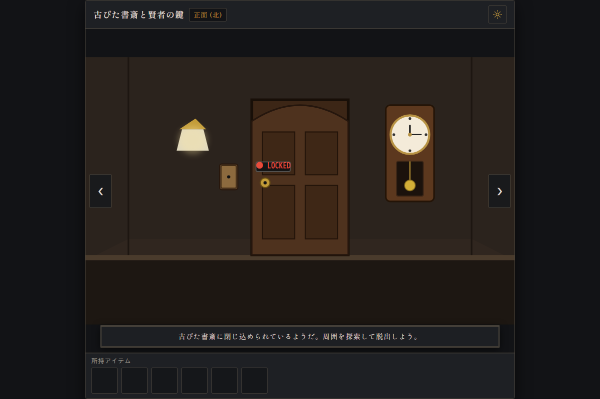
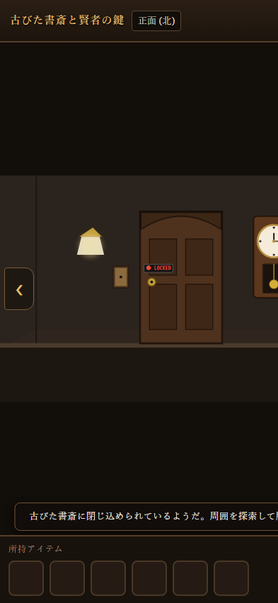
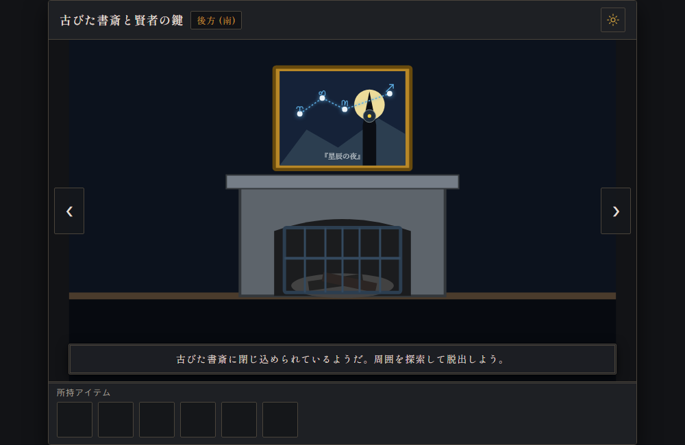
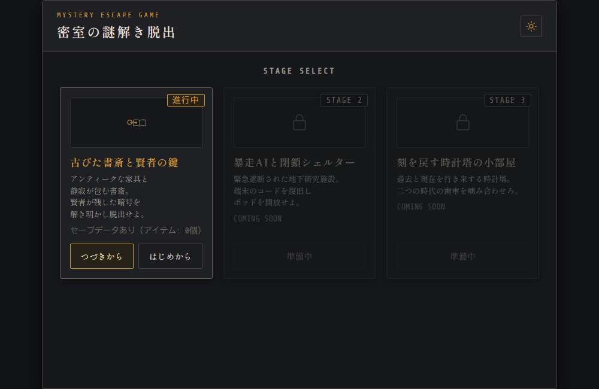

# 密室の謎解き脱出 (Mystery Escape Game)

外部フレームワークやゲームエンジンに一切依存せず、**Vanilla JavaScript (ES6+)、HTML5、CSS3、Web Audio API、インラインSVG** のみを用いてゼロから構築した、ブラウザ完結型の本格ポイント＆クリック脱出ゲームです。  
iOS / Android の PWA（Progressive Web App）に対応しており、「ホーム画面に追加」することでネイティブアプリ同様の全画面スタンドアロン体験でプレイできます。

---

## 📸 デモプレビュー

  <table>
    <tr>
      <td align="center" width="60%">
        <b>【PC / タブレット表示（通常探索）】</b> 
        
      </td>
      <td align="center" width="40%">
        <b>【スマートフォン縦画面表示】</b> 
        
      </td>
    </tr>
    <tr>
      <td align="center">
        <b>【照明OFF：暗闇モード（蓄光ギミック探索）】</b> 
        
      </td>
      <td align="center">
        <b>【ステージ選択 ＆ オートセーブメニュー】</b> 
        
      </td>
    </tr>
  </table>

---

## 🎮 プレイ用URL

👉 **[https://escape.xcangcheng.workers.dev/](https://escape.xcangcheng.workers.dev/)**  
※ PC・スマートフォン（iOS Safari / Android Chrome）のどちらのブラウザでも、インストール不要で即座にプレイできます。

---

## 📖 ゲーム概要と操作方法

### ■ コンセプト
プレイヤーは様々なシチュエーションの密室に閉じ込められた探索者となり、部屋の東西南北360度を見渡しながら、隠されたアイテムの発見・工具による分解・合成、照明や電力の切り替えによる環境変化、そして多層的な暗号・論理パズルを解き明かして脱出を目指します。

### ■ 収録ステージ（難易度順）

| ステージ | タイトル | 難易度 | テーマ・特徴 |
| :--- | :--- | :---: | :--- |
| **STAGE 1** | **古びた書斎と賢者の鍵** | ★★★☆☆ | **クラシック洋館ミステリー** 照明スイッチによる「暗闇モード」での蓄光壁画探索、天体運行日誌の東西方位推理、7冊の蔵書順列パズル、真鍮の天球儀と壁金庫が絡み合う多層謎解き。 |
| **STAGE 2** | **暴走AIと閉鎖シェルター** | ★★★★☆ | **SF・サバイバル・論理パズル** 管理AI「ARES」の暴走により完全封鎖された地下施設。100V〜140Vの配電グリッド電力配分、1,920通りのオシロスコープ波形同調、物理火災センサー実測値と連動するAI論理パラドックス監査、暗号PIN算出式。 |
| **STAGE 3** | **刻を戻す時計塔の小部屋** | ★★★★★ | *(開発予定)* 時間操作ギミックを取り入れた最難関パズル。 |

### ■ 操作方法
| アクション | 操作方法（スマホ / PC） |
| :--- | :--- |
| **視点の旋回** | 画面左右の「◀」「▶」ナビゲーションボタンをタップ、または画面スワイプ（北・東・南・西を360度ループ） |
| **オブジェクトの調査** | 気になる場所をタップ/クリックして拡大モーダルを表示 |
| **アイテムの選択** | 画面下部インベントリスロットをタップ（金色の枠線が点灯） |
| **アイテムの使用** | アイテム選択状態で対象のオブジェクト（鍵穴、ネジ、センサー等）をタップ |
| **アイテムの調べる（分解・合成）** | 選択中のアイテムスロットを「もう一度タップ」して詳細ダイアログを表示（工具でネジを外す、パーツ同士を結合するなど） |
| **各種設定・ステージ切替** | 画面右上の **⚙️（歯車アイコン）** から「音量ON/OFF」「最初からやり直す」「タイトルへ戻る」 |

---

## 🛠 使用技術一覧 (Tech Stack)

| カテゴリ | 技術・ツール | 選定理由・役割 |
| :--- | :--- | :--- |
| **Core Frontend** | **Vanilla JavaScript (ES6+)** | フレームワーク不使用。DOM操作・イベント駆動・状態遷移をピュアJSで高速制御。 |
| **Markup & Layout** | **HTML5 / CSS3** | セマンティックなマークアップ、Flexbox/CSS Grid、CSSカスタムプロパティ（変数）。 |
| **Graphics** | **Inline SVG (Vector)** | 外部画像ファイルゼロ。4Kモニタからスマホまで完全レスポンシブかつ劣化のないベクター描画。 |
| **Audio Synthesis** | **Web Audio API** | 外部音声（mp3/wav）のロード不要。オシレーター（発振器）による効果音のリアルタイム波形合成。 |
| **PWA & Manifest** | **Web App Manifest / iOS Meta** | スタンドアロン全画面起動、マルチ解像度アプリアイコン（180/192/512px）、セーフエリア（Safe Area）最適化。 |
| **Storage** | **Web Storage API (`localStorage`)** | ステージごとの独立した進行度・所持アイテム・フラグ・クリアタイムの完全自動永続化（オートセーブ）。 |
| **Hosting & Infra** | **Cloudflare Workers / Pages** | `wrangler.json` による静的アセット配信とブランチ別プレビュー環境（Static Assets & Previews）。 |
| **Dev & AI Pair** | **Google Antigravity / Git** | 高速なプロトタイピング、ペアプログラミングによるリファクタリング、Gitバージョン管理。 |

---

## 💡 技術的なこだわり・工夫した点 (Architecture & Engineering)

### 1. 外部依存ゼロ（Zero-Dependency）による究極の軽量化と瞬時起動
- **外部アセットの通信遅延ゼロ**: 画像ファイル（PNG/JPG）や音声ファイル（MP3）を一切使わず、部屋の景観・ギミック・アイテムアイコンは全て**インラインSVGコード**、効果音は **Web Audio API のオシレーターによる周波数合成（コード生成）** で実現しました。
- これにより、初回アクセス時のロード時間は実質ゼロとなり、オフライン環境や低速回線でもストレスなく瞬時にゲームが起動します。

### 2. マルチステージ独立状態管理と堅牢なオートセーブ
- 各ステージ専用の独立したストレージキー（`SAVE_KEY_1`, `SAVE_KEY_2`）を用意し、一方のプレイ状況を維持したまま別のステージをプレイ・リスタート可能。
- 部屋の視点方位、インベントリ、各パズルの状態フラグ、経過タイムなど、ゲームの全進行状態を1つの `state` オブジェクトに集約し、状態更新のたびに `localStorage` へ自動同期されます。

### 3. モバイルファーストの PWA ＆ セーフエリア（Edge-to-Edge）最適化
- **全画面スタンドアロン起動**: `display: standalone` と `apple-mobile-web-app-status-bar-style: black` により、ブラウザのアドレスバーを排除したネイティブアプリ同等の全画面没入感を提供。
- **完璧なセーフエリア追従**: iPhoneのノッチ・Dynamic Island・ホームバー領域に対して `env(safe-area-inset-*)` を上部ヘッダーと下部インベントリに正確に適用。画面端まで背景色を敷き詰めつつ、操作UIはセーフエリア内にジャストフィットします。

### 4. スマホファーストの日本語タイポグラフィとレスポンシブ組版
- **自然な文節改行**: 見出しやメッセージに `word-break: auto-phrase;`、`overflow-wrap: anywhere;`、`text-wrap: balance / pretty;` を適用し、日本語特有の単語・助詞の途中での不自然なブツ切り改行をCSSレベルで抑止。
- **文節スパン（`.phrase`）**: 重要な説明文やヒント文は ``（`display: inline-block; white-space: nowrap;`）で意味のまとまりごとに構造化。PCなどの大画面では1行で美しく中央揃えされ、スマホの狭い画面では文節の境目で自然に折り返されます。
- **文字溢れゼロ設計**: ボタンやステータス表示には `white-space: nowrap;` と `font-size: clamp(...)` を掛け合わせ、いかなる画面サイズ（320px〜4K）でも文字の枠はみ出しやレイアウト崩れが発生しません。

---

## 🚀 開発中に直面した課題と解決策 (Problem Solving)

### 課題1: パズルの総当たり（当てずっぽう）とヒント重複によるゲーム性の破綻
- **直面した問題**:  
  初期設計の本棚パズルは本が4冊（$4! = 24$通り）しかなく、プレイヤーがノーヒントで当てずっぽうに押しても数分で解けてしまう問題がありました。
- **解決アプローチ**:  
  1. 本棚の蔵書を**7冊（順列 $_{7}P_{4} = 840$通り）**へと大幅に拡張。4冊押し終えるまで判定を伏せることで総当たりを数学的に防止しました。
  2. 天体日誌を「時計パズルの東西方位推理」専用とし、油絵は「本棚パズルの星座順序」専用へと役割を完全分離。
  3. 部屋の西側に「真鍮の天球儀」ギミックを新設し、多層的で満足度の高いゲームフローへとリファクタリングしました。

### 課題2: Stage 2 における総当たりの徹底排除と物理連動パズル設計
- **直面した問題**:  
  Stage 2 の初期設計では、オシロスコープが64通りで自動判定され、AI監査コンソールも8通りでマニュアルに答えが直書きされていたため、ボタン連打で解けてしまう懸念がありました。
- **解決アプローチ**:  
  1. **オシロスコープを1,920通りへ拡張**: 波形（4種）× 周波数（10段階）× 位相（8段階）× 振幅（6段階）とし、「送信実行ボタン」でのみ判定。基準クロックの高調波計算や逆位相の加算など、室内資料を読み解く計算パズルへ昇華。
  2. **物理センサー実測値との連動（虚偽申告防止）**: AI論理監査コンソール（256通り）では、室内火災の条項を選択しても、実際に西壁の火災温度センサーをサーマルトーチで加熱（78.0℃）していなければ「実測値（18℃）と一致しません」とAIに論破されて弾かれる物理・論理連動ギミックを実装。
  3. **暗号PINのフォーミュラ化**: 暗号数字の直書きを廃止し、加熱した実測温度や同調パラメータから導く4桁算出式を推理させる構造へ強化。

### 課題3: iOS PWA/スタンドアロン起動時における画面上ズレとヘッダーブラー
- **直面した問題**:  
  iPhoneで「ホーム画面に追加」して全画面起動した際、iOSのステータスバー領域にコンテンツが食い込んで画面上部が切れたり、ヘッダー上半分がブラー（ぼかし）表示されてしまう不具合が発生しました。
- **解決アプローチ**:  
  1. ステータスバー表示を `black` に固定し、最上位コンテナで `env(safe-area-inset-top)` を正確に加算。
  2. 画面最上部に高さ11pxのWebKit用色検出要素（`.ios-blur-fix`）を配置し、スクロールエッジエフェクトの不要なぼかしを完全に抑止しました。

---

## 📜 開発履歴 (Development Log)

日ごとのコミット推移、機能実装ログ、および詳細な謎解きフローチャート（Mermaid図）は、以下の開発日誌にて公開・随時更新しています。

👉 **[詳細な開発日誌を見る (DEVLOG.md)](DEVLOG.md)**

---

## 📄 ライセンス

本プロジェクトは [MIT License](LICENSE) のもとで公開されています。
